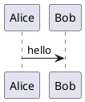

# Rspress UI 组件

阅读页由 Rspress 渲染。下面这些是页面上能直接看到的部分。

## 导航与侧栏

顶栏来自 `themeConfig.nav`，左侧目录来自 `themeConfig.sidebar`。当前内置入口是本页、接入指南和链接文档。

搜索框使用 Rspress 的本地搜索，索引的是构建进站点的 Markdown。

## 正文与大纲

正文在 `.rspress-doc` 里。右侧大纲是 Rspress 的 Outline，对应 `.rp-doc-layout__outline`。本站把大纲宽度设为 360px。

正文右缘有一条竖向把手。拖动它会改变 `--rp-content-max-width`，并记在浏览器的 `dooc-content-width` 里，用来在宽屏上拉宽或收窄正文。

## 批注列

批注列在大纲右侧，宽 300px。窄于 1280px 时，批注改到正文下方。

在正文里松开选择后，选区末行外侧出现「批注」按钮，不盖住选中的文字。点按钮后，输入框出现在选区下方。批注锚点是标题、引用原文和出现次数，保存在 SQLite，不写回 Markdown。

同一标题下可以跨行选择。引用保存的是 Markdown 源码切片，所以换行会留在锚点里。

## 代码块渲染

普通代码块仍由 Rspress 显示。下面四种语言会就地渲染，失败时把错误原文留在原位置。

Mermaid：


PlantUML 使用 `plantuml` 或 `puml`。编译器不可用或源码有误时，页面显示编译输出。



Excalidraw 使用场景 JSON。元素目前支持 rectangle、ellipse、diamond、text、line、arrow。JSON 不合法或元素类型不支持时，显示解析错误。

```excalidraw
{
  "type": "excalidraw",
  "elements": [
    { "type": "rectangle", "x": 20, "y": 20, "width": 160, "height": 64, "strokeColor": "#1e1e1e", "backgroundColor": "transparent" },
    { "type": "text", "x": 36, "y": 40, "text": "目录", "fontSize": 18, "strokeColor": "#1e1e1e" }
  ]
}
```

HTML 嵌入使用 `html-embed`。内容放进带 `sandbox="allow-scripts"` 的 iframe，解析失败时显示浏览器的 parsererror。

```html-embed
<p>这段 HTML 嵌在阅读页里。</p>
```

## 编辑正文

阅读页右下角的「编辑正文」会先锁定当前文件，再打开源码。保存写回原文件并释放锁。取消也会释放锁。
