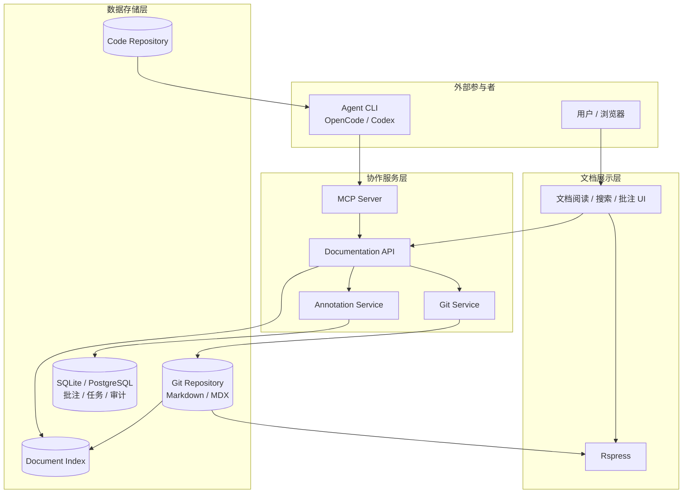

# Agent 协作文档系统技术设计方案

> 基于 Rspress、Git、MCP 和 Agent Skills 构建的开放式文档协作系统。

- 版本：v0.1
- 状态：技术方案设计
- 核心框架：Rspress
- Agent 运行环境：外部 Agent CLI（OpenCode、Codex 等）

---

## 1. 项目目标

构建一个以 Markdown 为核心的文档协作平台，实现代码仓库、文档站、外部 Agent 和用户之间的双向协作。

系统需要支持：

1. 从代码仓库提取信息，辅助生成和维护设计文档。
2. 用户通过现代化文档站阅读文档。
3. 用户能够对文档进行批注，并向 Agent 下达任务。
4. 外部 Agent 能够读取文档、理解文档结构、查询批注。
5. 外部 Agent 能够修改文档、创建批注、提交修订。
6. 文档修改具有版本追踪、差异对比和人工审核能力。
7. 通过 MCP 和 Agent Skills 对接不同 Agent CLI，不依赖任何特定 Agent 实现。

### 1.1 非目标

本项目不负责：

- 实现自己的 Agent Runtime。
- 实现模型推理和模型供应商管理。
- 取代 Git 作为文档版本管理系统。
- 将文档正文存储在专有数据库中。
- 强制用户使用某个特定 Agent CLI。

## 2. 总体架构



### 2.1 架构分层

| 层级 | 技术 | 主要职责 |
|---|---|---|
| Presentation | Rspress + React | 页面渲染、阅读、批注、交互 |
| Content | Markdown / MDX + Git | 文档内容和历史版本 |
| Backend | Node.js + TypeScript | API、权限、批注、Git 操作 |
| Agent Integration | MCP + Agent Skills | 外部 Agent 对接 |
| Persistence | Git + SQLite/PostgreSQL | 正文、批注、审计和索引 |

各层通过稳定接口交互，避免业务逻辑与 Rspress 或某个 Agent CLI 耦合。

## 3. 技术选型

### 3.1 文档框架：Rspress

选择 Rspress 作为文档展示框架。

主要原因：

- React 技术栈，支持自定义组件。
- 原生支持 Markdown 和 MDX。
- 支持主题定制和插件扩展。
- 支持全文搜索、国际化和多版本文档。
- 支持 SSG-MD，提供面向 AI 的 Markdown 页面输出。
- 支持 `llms.txt` 和 `llms-full.txt`。
- 支持通过插件扩展 Markdown 编译、页面数据和构建行为。

设计原则：

**Markdown 为主，MDX 为辅。**

正文尽可能使用标准 Markdown。只有需要交互能力的场景才使用 MDX 组件。

### 3.2 后端：Node.js + TypeScript

建议使用独立的 Node.js 服务。

职责：

- 文档查询和索引。
- 批注 CRUD。
- 文档修改和版本管理。
- Git 分支、提交和 Diff。
- MCP Server。
- 用户身份认证和权限控制。
- 审计日志。

初期不建议引入复杂微服务架构，采用模块化单体即可。

### 3.3 数据存储

| 数据 | 存储 |
|---|---|
| 文档正文 | Git |
| 文档历史 | Git |
| 用户批注 | SQLite / PostgreSQL |
| 批注状态 | SQLite / PostgreSQL |
| 文档索引 | SQLite FTS / PostgreSQL |
| 操作审计 | PostgreSQL 或结构化日志 |
| Agent 任务 | 初期可存储在数据库 |

正文和批注分离，避免批注修改污染文档正文和 Git 历史。

## 4. 文档数据模型

### 4.1 文档目录

```text
project/
├── AGENTS.md
├── docs/
│   ├── index.md
│   ├── architecture/
│   ├── design/
│   ├── decisions/
│   ├── guides/
│   └── api/
├── .agents/
│   └── skills/
│       ├── docs-read/
│       │   └── SKILL.md
│       ├── docs-write/
│       │   └── SKILL.md
│       ├── docs-review/
│       │   └── SKILL.md
│       └── code-to-docs/
│           └── SKILL.md
├── meta/
│   ├── doc-code-map.yaml
│   └── taxonomy.yaml
├── packages/
│   ├── docs-web/
│   ├── docs-api/
│   └── docs-mcp/
└── package.json
```

### 4.2 文档元数据

使用 Frontmatter 描述文档属性。

```yaml
---
id: architecture.agent-system
title: Agent 系统架构
description: 系统 Agent 交互和执行架构
type: architecture
status: reviewed
tags:
  - architecture
  - agent
owners:
  - engineering
code_refs:
  - src/agent/
  - src/runtime/
symbols:
  - AgentRuntime
  - AgentContext
created_at: 2026-11-04
updated_at: 2026-11-04
---
```

其中：

- `id`：稳定文档标识，不依赖文件路径。
- `type`：文档类型。
- `status`：文档状态。
- `code_refs`：关联代码路径。
- `symbols`：关联代码符号。
- `owners`：维护责任人。

Agent 修改文档时必须保留稳定 ID。

### 4.3 文档类型

建议统一以下类型：

| 类型 | 说明 |
|---|---|
| architecture | 架构设计 |
| design | 详细设计 |
| adr | 架构决策记录 |
| api | API 文档 |
| guide | 使用指南 |
| reference | 技术参考 |
| analysis | 分析报告 |

## 5. 批注系统

### 5.1 独立存储

批注不直接写入 Markdown。

采用独立的 Annotation Store。

数据结构：

```json
{
  "id": "comment-001",
  "doc_id": "architecture.agent-system",
  "anchor": {
    "heading": "系统总体架构",
    "quote": "Agent Runtime",
    "occurrence": 1
  },
  "author": {
    "type": "user",
    "id": "user-001"
  },
  "content": "需要补充 Agent 的生命周期。",
  "status": "open",
  "created_at": "2026-11-04T10:00:00Z",
  "updated_at": "2026-11-04T10:00:00Z"
}
```

### 5.2 批注状态

```text
open
  ↓
in_progress
  ↓
resolved

open / in_progress
  ↓
dismissed
```

支持：

- 用户批注。
- Agent 批注。
- 回复和讨论。
- 状态变更。
- 关联文档版本。
- 关联代码提交。

### 5.3 锚点设计

不使用单纯的行号作为批注定位依据。

推荐使用：

- 文档 ID。
- 标题路径。
- 选中文本。
- 文本前后文。
- 文档版本 SHA。

当文档发生变化时，通过文本匹配恢复锚点；无法确定时标记为 orphaned，交由用户或 Agent 重新定位。

## 6. MCP Server 设计

### 6.1 设计目标

MCP Server 是外部 Agent CLI 访问文档系统的统一入口。

不为 OpenCode、Codex 单独实现不同的业务接口。

建议提供：

- MCP Tools：操作能力。
- MCP Resources：文档和批注上下文。
- MCP Prompts：标准化工作流程模板。

### 6.2 MCP Tools

#### 文档查询

| Tool | 参数 | 功能 |
|---|---|---|
| docs_search | query, filters | 搜索文档 |
| docs_get | doc_id | 获取完整文档 |
| docs_get_outline | doc_id | 获取文档结构 |
| docs_get_related | doc_id | 获取关联文档 |
| docs_get_code_refs | doc_id | 获取关联代码 |

#### 批注操作

| Tool | 参数 | 功能 |
|---|---|---|
| comments_list | doc_id, status | 查询批注 |
| comments_get | comment_id | 获取批注详情 |
| comments_create | doc_id, anchor, content | 创建批注 |
| comments_reply | comment_id, content | 回复批注 |
| comments_update_status | comment_id, status | 修改批注状态 |

#### 文档修改

| Tool | 参数 | 功能 |
|---|---|---|
| docs_propose_edit | doc_id, patch, reason | 提出修改 |
| docs_get_diff | change_id | 查看修改差异 |
| docs_validate | doc_id / change_id | 校验文档 |
| docs_submit_change | change_id | 提交审核 |
| docs_get_history | doc_id | 查询历史版本 |

#### 任务管理

| Tool | 参数 | 功能 |
|---|---|---|
| tasks_create | title, description | 创建文档任务 |
| tasks_list | filters | 查询任务 |
| tasks_get | task_id | 获取任务详情 |
| tasks_update | task_id, status | 更新任务状态 |

### 6.3 MCP Resources

建议提供以下资源：

```text
docs://index
docs://document/{doc_id}
docs://document/{doc_id}/outline
docs://document/{doc_id}/comments
docs://document/{doc_id}/history
docs://task/{task_id}
docs://standards/markdown
docs://standards/document-types
```

Resources 用于提供可读取的上下文，不应把所有文档一次性注入 Agent 上下文。

### 6.4 MCP Prompts

建议提供：

```text
analyze-code-to-docs
review-document
process-comment
update-document
generate-design-document
```

这些 Prompt 提供标准任务模板，实际工作流仍由 Agent 执行。

### 6.5 修改安全策略

Agent 不应拥有无条件修改生产文档的能力。

建议：

```text
读取文档
  ↓
生成修改建议
  ↓
创建 Change
  ↓
查看 Diff
  ↓
文档校验
  ↓
提交审核
  ↓
人工批准
  ↓
合并 Git
  ↓
Rspress 自动构建
```

MCP Server 需要执行权限检查、版本检查和路径校验。

## 7. Agent Skills 设计

### 7.1 为什么需要 Skill

MCP 只告诉 Agent 有哪些工具，以及如何调用。

但它不会自动让 Agent 理解：

- 文档应该如何组织。
- 什么情况下应该创建新文档。
- 如何分析代码与现有文档的差异。
- 如何处理用户批注。
- 如何保证设计文档的完整性。
- 如何避免无意义地重写文档。

这些规范应通过 Agent Skills 提供。

### 7.2 Skill 目录

```text
.agents/skills/
├── docs-read/
│   ├── SKILL.md
│   └── references/
│       └── document-structure.md
├── docs-write/
│   ├── SKILL.md
│   ├── references/
│   │   ├── markdown-style.md
│   │   └── document-template.md
│   └── scripts/
│       └── validate-frontmatter.py
├── docs-review/
│